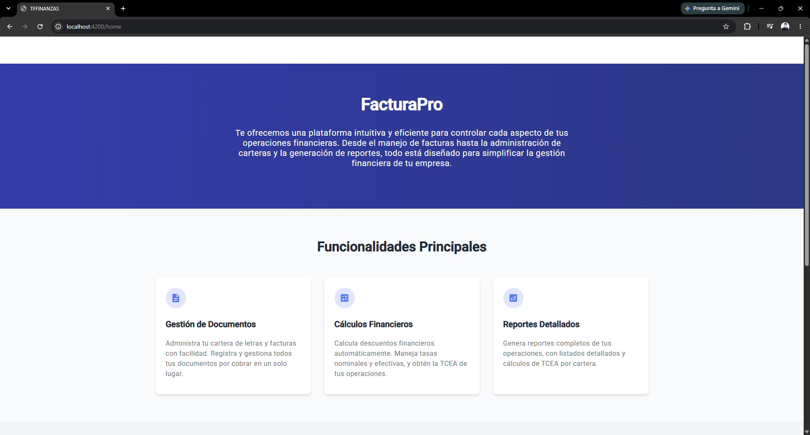

# FacturaPro — Frontend

Angular web client for **FacturaPro**, an application for managing discounted invoice and bill-of-exchange portfolios (*carteras de descuento*). Users register invoices (*facturas*) and bills of exchange (*letras*), group them into portfolios linked to a bank, and see how much they actually receive after interest, fees and taxes, along with the portfolio's annual effective cost rate (**TCEA**).

> Academic project for the course *Finanzas e Ingeniería Económica* (SI642), Universidad Peruana de Ciencias Aplicadas (UPC), 2024-2.

- **Backend (Spring Boot):** [Carlou134/TF_FINANZAS](https://github.com/Carlou134/TF_FINANZAS)



## The problem

Small and medium-sized businesses often need cash before their customers pay. A company holding an invoice for S/ 10,000 due in 90 days can discount it with a bank and get the money today, minus interest, fees and taxes. FacturaPro automates that analysis: how much the company actually receives and what the operation really costs.

## Features

- **Authentication:** login and sign-up against the backend's JWT endpoint. The token is kept in `sessionStorage` and attached to every request by an HTTP interceptor.
- **Role-based navigation:** banks, exchange rates, users and roles are only shown to `ADMIN` users.
- **Banks, debtors and exchange rates:** list, create and edit.
- **Portfolios:** create portfolios with a bank, discount date and currency (PEN or USD), and view the documents in each one.
- **Documents:** register invoices and bills of exchange with live financial calculations as the form is filled in.
- **PDF reports:** export a portfolio's documents to a landscape A4 PDF (jsPDF + AutoTable).
- **Profile:** update the current user's information.

## Financial logic

Each document's figures are calculated in the form (`documentos-crea-edita.component.ts`) before it is saved:

| Step              | Formula                                                     |
| ----------------- | ----------------------------------------------------------- |
| Nominal → effective rate | `TE = (1 + TN / m)^n − 1`                            |
| Rate for the term | `TE_term = (1 + TE)^(days_term / days_rate) − 1`            |
| Discount rate     | `d = TE_term / (1 + TE_term)`                               |
| IGV               | `18% × (postage + fees)`                                    |
| Net value         | `nominal − nominal × d − fees − IGV`                        |
| Discount days     | days between the portfolio's discount date and the due date |

The portfolio totals and the consolidated TCEA are calculated by the backend.

## Tech stack

| Area           | Technology                          |
| -------------- | ----------------------------------- |
| Framework      | Angular 18 (NgModules + standalone) |
| Language       | TypeScript 5.5                      |
| UI             | Angular Material                    |
| Forms          | Reactive Forms                      |
| HTTP           | HttpClient + auth interceptor       |
| Authentication | `@auth0/angular-jwt`                |
| Reports        | jsPDF + jspdf-autotable             |
| Rendering      | Angular SSR / prerendering          |

## Project structure

```
src/app/
├── component/        # Feature screens (one folder per module)
│   ├── bancos/  cartera/  deudores/  documentos/
│   ├── users/  role/  valor-dolar/
│   ├── login/  home/  pagina-principal/
│   └── actualizar-user/  soporte-tecnico/
├── interceptors/     # Adds the Bearer token to requests
├── models/           # TypeScript models matching the API DTOs
└── service/          # HTTP services and auth guard
```

Each feature follows the same pattern: a parent component with a `*-listar` (list) and a `*-crea-edita` (create/edit) child.

## Routes

| Route                             | Screen                      |
| --------------------------------- | --------------------------- |
| `/home`                           | Landing page                |
| `/login`, `/register`             | Login and sign-up           |
| `/components/pagina-principal`    | Dashboard                   |
| `/components/cartera`             | Portfolios                  |
| `/components/documentos/:id`      | Documents of a portfolio    |
| `/components/bancos`              | Banks (admin)               |
| `/components/valor-dolar`         | Exchange rates (admin)      |
| `/components/deudores`            | Debtors                     |
| `/components/usuarios`, `/roles`  | Users and roles (admin)     |

## Getting started

### Prerequisites

- Node.js 18+
- Angular CLI 18 (`npm install -g @angular/cli`)
- The [backend](https://github.com/Carlou134/TF_FINANZAS) running locally or deployed

### Configuration

Set the API URL in `src/environments/environment.ts`:

```ts
export const environment = {
  production: false,
  base: "http://localhost:8080",
};
```

### Run

```bash
npm install
ng serve
```

Open `http://localhost:4200`.

### Build

```bash
ng build
```

The output goes to `dist/tffinanzas/`. To serve the SSR build:

```bash
npm run serve:ssr:TFFINANZAS
```

## Known limitations

- The per-document net value uses a simple discount rate, while the backend discounts each document to present value when computing portfolio totals, so both figures can differ.
- There are no unit tests for the financial calculations yet.

## Context

Built as the final project for SI642 at UPC (Group 02), November 2024.
